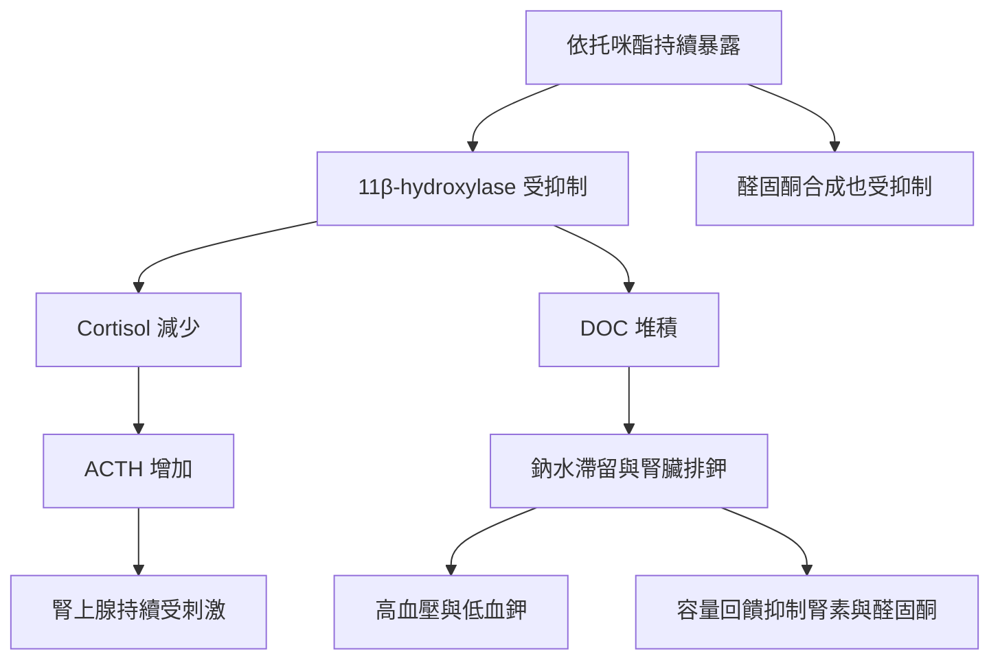

> **文章狀態｜資料截至 2026-10-23**
> 反覆吸入依托咪酯的臨床證據，目前以病例報告為主。本文依據已發表病例的全文、藥品仿單、2025 年 Endocrine Society 原發性醛固酮症指引，以及行政院公報整理。[1–4,6–8]

高血壓合併低血鉀，會讓人想到「醛固酮是不是分泌過多？」這是合理的診斷方向。但如果檢驗發現，腎素與醛固酮都受到抑制，就需要進一步追問：是什麼讓腎臟持續留鈉、排鉀？

**依托咪酯（etomidate）相關的假性醛固酮增多症，就是其中一個值得辨認的原因**。反覆接觸含此成分的電子煙油，可能影響腎上腺荷爾蒙合成，使身體出現類似醛固酮過多的效果。[1,2]

> 先記住核心機轉：依托咪酯抑制類固醇合成，可能讓 cortisol 降低、ACTH 升高，並使具有礦物皮質素作用的前驅物 DOC 堆積。

## 文獻中的患者，不一定只有一種表現

2024 年的一篇病例報告描述兩位使用含依托咪酯電子煙的男性，因肢體無力就醫，入院時血鉀分別為 **1.69 與 1.80 mmol/L**。第二位入院時血壓 161/96 mmHg；第一位為 132/88 mmHg，並沒有高血壓。兩人也出現不同程度的腎上腺及荷爾蒙異常。[1]

另一篇報告中的 35 歲女性，則以月經異常、多毛、聲音低沉等雄性素過多表現就醫，血壓 165/101 mmHg。檢查支持後天性 11β-hydroxylase 活性受抑制；她的血鉀在追蹤期間卻沒有明顯異常。[2]

三位病人中，高血壓與低血鉀同時出現的只有一位。這提醒我們：**低血鉀是重要線索，但不是每位暴露者都會出現；也不能只靠一組典型檢驗結果確認或排除診斷。**

## 為什麼醛固酮低，血壓還是可能升高？

可以把腎上腺想成一座荷爾蒙工廠：前驅物是原料，酵素負責把原料轉成下游荷爾蒙。

依托咪酯會抑制 **11β-hydroxylase（CYP11B1）**。這個酵素參與兩項轉換：

- **11-deoxycortisol → cortisol（皮質醇）**。
- **11-deoxycorticosterone，簡稱 DOC → corticosterone（皮質酮）**。

轉換受阻後，下游成品可能減少，上游前驅物則可能增加。這裡最重要的主角是 **DOC**：它本身具有礦物皮質素作用，增加時可以促進鈉水滯留與腎臟排鉀，造成高血壓、低血鉀。[1]

體液容量擴張又會抑制腎素－醛固酮系統；此外，依托咪酯本身也會抑制醛固酮的合成。[1] 因此，患者可能同時出現「血壓高、血鉀低」，以及「腎素低、醛固酮低」。

這就是「假性醛固酮增多症」的意思：身體呈現類似醛固酮過多的效果，但不必然是醛固酮分泌過多。

## 同一個人，也可能有 cortisol 不足

Cortisol 減少時，對腦下垂體的負回饋降低，促腎上腺皮質素 **ACTH** 就可能增加。持續刺激可伴隨腎上腺皮質增生，以及類固醇前驅物、雄性素的異常。[1,2]

因此，**高血壓可以與糖皮質素不足並存**。血壓高，不能當成腎上腺壓力反應足夠的證明；遇到感染、手術或其他重大壓力時，仍須依臨床情境評估。[2,3]

## 檢驗怎麼看？別只盯著 ARR

在高血壓合併低血鉀的評估中，腎素與醛固酮的組合可提供方向：

| 典型型態 | 腎素 | 醛固酮 | 判讀方向 |
| --- | --- | --- | --- |
| 原發性醛固酮增多症 | 受抑制 | 相對於腎素不適當偏高 | 評估自主性醛固酮分泌 |
| 本文討論的假性型態 | 受抑制 | 偏低 | 尋找其他礦物皮質素作用來源，並整合暴露史 |

這張表是判讀方向，並非單次抽血即可確診的規則。[1,4]

醛固酮／腎素比值（ARR）的分母若非常低，比值可能看起來很高。**必須同時看醛固酮的絕對濃度、檢驗方法與採檢條件**。[4]

還有一個容易忽略的陷阱：**低血鉀本身就可能壓低醛固酮，造成篩檢偽陰性**。依 2025 年 Endocrine Society 指引，若臨床仍懷疑原發性醛固酮增多症，應矯正低血鉀、評估藥物干擾，再安排適當複驗。患者不應自行停用降壓藥來準備抽血。[4] 原發性醛固酮症的篩檢對象與 ARR 判讀細節，見[何時該篩 PA：哪些高血壓必須篩檢](/pa/q01-screening-indication/)與[ARR 切點與藥物洗脫：怎麼驗才不會驗錯](/pa/q02-arr-cutoff-washout/)。

## 暴露史，要問得具體

只問「有沒有使用毒品」，可能得不到完整資訊。患者可能不知道煙油的實際成分，也不會把朋友提供的煙彈視為藥物。

可以中性地詢問：「最近有沒有使用電子煙、來路不明的煙油，或會讓人特別想睡的煙彈？」再釐清頻率、最後使用時間及其他物質暴露。[2]

「喪屍煙彈」「睡眠煙彈」「一口暈」等俗稱可以作為詢問線索，但不能靠外觀或商品名稱確認成分。[5]

檢驗方面，應先確認所在醫院的毒物檢驗是否涵蓋依托咪酯、類似物與相關代謝物；必要時與毒物或檢驗單位討論針對性分析。上述 35 歲女性的病例，是以廣泛毒物分析在尿液驗出依托咪酯代謝物（etomidate acid），並在煙油驗出依托咪酯及其類似物 propoxate／isopropoxate。[2] **血中半衰期、尿液檢出時間與內分泌效應的持續時間，不能畫上等號**。[2,3]

## 在台灣：已列為第一級毒品

依托咪酯在醫療上是靜脈麻醉誘導用藥。行政院於 2024 年 8 月將它列為第三級毒品，同年 11 月改列第二級；**2026 年 6 月 27 日起，依托咪酯與美托咪酯、丙帕酯（含異丙帕酯）等多種類似物改列第一級毒品**，依托咪酯酸（etomidate acid）則列為第四級毒品先驅原料。[6–8]

分級提高後，病人說出使用史的顧慮可能更大。問診時維持中性、不帶評價的態度，並說明詢問是為了找出低血鉀與腎上腺異常的原因，比較有機會得到完整資訊。

## 處置：先穩定患者，再追蹤恢復

急性中毒以支持治療為主，評估意識、呼吸與通氣，必要時保護呼吸道。依托咪酯雖有相對穩定的血流動力學特性，仍可能引起低通氣、呼吸暫停或呼吸道阻塞。[1,3]

若合併低血鉀與內分泌異常，處置重點包括：

1. **停止持續暴露，連結成癮照護。**
2. **處理電解質與血壓問題**。依嚴重度評估心電圖、血鉀、鎂與腎功能，安排矯正及監測。
3. **評估腎上腺功能**。是否需要糖皮質素補充，須依症狀、功能檢查與壓力狀態決定，並非所有暴露者都使用相同療程。[1–3]

追蹤時，血鉀與血壓改善，也不能直接代表腎上腺功能已完全恢復。反覆吸入暴露的病程，不能套用單次靜脈麻醉的恢復時間。[2,3]

若出現明顯肢體無力、心悸、昏厥、呼吸異常或意識改變，應儘速就醫，並主動告知可能的暴露內容。

## 把這組檢驗當成進一步追問的線索

遇到高血壓、低血鉀，合併低腎素、低醛固酮時，應把藥物與生活暴露納入鑑別。若再伴隨低 cortisol、高 ACTH，依托咪酯相關的類固醇合成障礙就更值得考慮。

目前反覆吸入依托咪酯的臨床證據仍以病例與病例系列為主，足以提醒臨床辨認風險，尚不能據此推算所有使用者的發生率，或保證固定的恢復時間。[1,2]

## 機轉複習圖

以下為簡化機轉圖。Cortisol 與 corticosterone 是不同物質；醛固酮偏低同時來自容量回饋與依托咪酯對醛固酮合成的直接抑制。[1]

## 延伸閱讀

- [何時該篩 PA：哪些高血壓必須篩檢](/pa/q01-screening-indication/)
- [ARR 切點與藥物洗脫：怎麼驗才不會驗錯](/pa/q02-arr-cutoff-washout/)

## 醫療免責聲明

本文僅供醫學資訊、專業教育與臨床討論參考，不提供個別診斷或治療建議，也不能取代實際診療與個別化醫療判斷。低血鉀、高血壓與腎上腺功能異常的評估與治療，應由負責醫師依完整病史、檢驗結果與臨床狀況決定。

若有肢體無力、心悸、昏厥、呼吸異常或意識改變，請立即就醫。本文整理的資料截至 2026-10-23；後續研究與法規公告都可能改變本文內容。

## 參考資料

- **[1]** Wu W, Xia C, Gan L, Liao S, Yan Y. Etomidate-induced hypokalemia in electronic cigarette users: two case reports and literature review. *Front Endocrinol (Lausanne)* 2024;15:1321610。DOI **10.3389/fendo.2024.1321610**；PMID **38872965**。[全文](https://pmc.ncbi.nlm.nih.gov/articles/PMC11169611/)
- **[2]** Lau CY, Cheung YTT, Han TMA, Chung CMJ, Chong YK, Chen PLS. Acquired 11β-hydroxylase Deficiency by Inhaled Etomidate and its Analogues: A Mimic of Congenital Adrenal Hyperplasia. *JCEM Case Rep* 2024;2(12):luae207。DOI **10.1210/jcemcr/luae207**；PMID **39569044**。[全文](https://pmc.ncbi.nlm.nih.gov/articles/PMC11577607/)
- **[3]** DailyMed. AMIDATE（etomidate injection）, Hospira, Inc.：Clinical Pharmacology、Adverse Reactions、Overdosage（2026-10-23 查閱）。此為靜脈用藥資料，不能直接推估反覆吸入暴露的藥動學與恢復時間。[仿單](https://dailymed.nlm.nih.gov/dailymed/lookup.cfm?setid=b7ed5bf8-ba75-44dc-8f81-96b4ad5766be)
- **[4]** Adler GK, Stowasser M, Correa RR, et al. Primary Aldosteronism: An Endocrine Society Clinical Practice Guideline. *J Clin Endocrinol Metab* 2025;110(9):2453-2495。DOI **10.1210/clinem/dgaf284**；PMID **40658480**。
- **[5]** 法務部反毒大本營（專業版）。依託咪酯（Etomidate）：毒品級別與俗名（公告日期 2026-06-11；2026-10-23 查閱）。[官方頁面](https://antidrug.moj.gov.tw/cp-1212-9648-2.html)
- **[6]** 行政院公告，中華民國 113 年 8 月 5 日院臺法字第1131020962號：增列依托咪酯為第三級毒品。行政院公報第 030 卷第 146 期（2024-08-06）。[公報](https://gazette.nat.gov.tw/egFront/detail.do?metaid=151192&log=detailLog)
- **[7]** 行政院公告，中華民國 113 年 11 月 27 日院臺法字第1131031622號：依托咪酯修正為第二級毒品。行政院公報第 030 卷第 223 期（2024-11-28）。[公報](https://gazette.nat.gov.tw/egFront/detail.do?metaid=153697&log=detailLog)
- **[8]** 行政院公告，中華民國 115 年 6 月 25 日院臺法字第1155013102號：依托咪酯及其類似物修正為第一級毒品、依托咪酯酸增列為第四級毒品先驅原料，自 115 年 6 月 27 日生效。行政院公報第 032 卷第 116 期（2026-06-26）。[公報](https://gazette.nat.gov.tw/egFront/detail.do?metaid=166554&log=detailLog)
